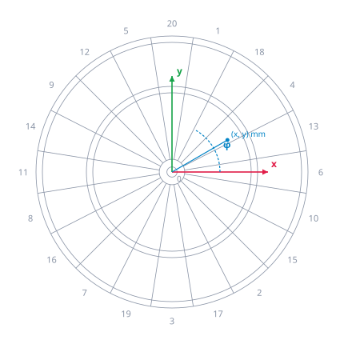

# Board coordinates

Every result, annotation and benchmark in DartPilot uses the board coordinates defined here. Geometry (#13, #47) produces points in them, the scorer (#12) reads them, and ground truth (#14) is written in them.



## Frame

| | Convention |
| - | - |
| Origin | Centre of the inner bull, on the playing surface |
| x axis | In the board plane, from the centre towards the middle of sector 6 |
| y axis | In the board plane, from the centre towards the middle of sector 20 |
| z axis | Normal to the board, out of the board towards the thrower; the frame is right-handed |
| Unit | Millimetre (`_mm`) |
| Playing surface | z = 0. The wires lie above it, at about z = 1 to 1.5 mm (#47) |

The frame is fixed to the board, not to gravity or the room: its y axis runs through the middle of sector 20 as the board is mounted. A board that hangs a few degrees rotated keeps the same coordinates, and the extrinsic calibration (#13) finds that rotation.

**Polar form.** A point (x, y) has the radius r = √(x² + y²) and the angle φ = atan2(y, x), counter-clockwise from the x axis, in degrees from 0 to 360. The middle of sector 6 lies at φ = 0°, sector 20 at φ = 90°.

## Sectors

The twenty sectors are 18° wide; their boundaries, the radial wires, lie at φ = 9° + k · 18° (k = 0 … 19). Clockwise from the top, the sector numbers are

```text
20  1  18  4  13  6  10  15  2  17  3  19  7  16  8  11  14  9  12  5
```

so the sector whose middle lies at φ = 90° − i · 18° has the i-th number of this list (i = 0 … 19).

## Rings

Nominal radii of a tournament board, measured from the origin. They are the boundaries the scorer uses until a measured board model exists:

| Boundary | Radius (mm) |
| - | - |
| Inner bull (bull, 50) | 6.35 |
| Outer bull (25) | 15.9 |
| Inner edge of the triple ring | 99.0 |
| Outer edge of the triple ring | 107.0 |
| Inner edge of the double ring | 162.0 |
| Outer edge of the double ring (end of the scoring area) | 170.0 |

The nominal values are good to about a wire thickness (around 1 mm): boards differ between makers, and the wires have a width. The measured board model from the wire detection (#47) replaces them per board, with the wire positions as they are, and is stored with the extrinsic calibration. The scorer therefore takes the geometry as input instead of using fixed constants.

**Boundaries.** A point exactly on a boundary belongs to the region further out: a radius of exactly 99.0 mm is triple, exactly 170.0 mm is a miss; an angle exactly on a radial wire belongs to the sector counter-clockwise from it. Physically a dart cannot stick in a wire, so this only matters for the deterministic scorer, which reports the distance to the nearest boundary (#12) for every point anyway.

## Results and ground truth

An impact position is a **board point**:

| Field | Meaning |
| - | - |
| `x_mm`, `y_mm` | Position in the board plane |
| `covariance_mm2` | 2×2 covariance of the position (xx, xy, yy) in mm² |
| `source` | Where it comes from: an engine result, or a ground-truth method (#14) |
| `frames` | Source frame IDs per camera, so every point is traceable |

Ground truth uses the same fields; its covariance states the uncertainty of the reference method, which #14 measures. **The score is never annotated or stored on its own**: it is always derived from the board point by the scorer, so a scorer change cannot leave stale scores behind, and a position error is never mistaken for a scoring error. Throws without a board point (bounce-out, dart outside the board, dart missed by the reference) carry a reason instead of a point.

Benchmarks compare board points: the radial error is the distance between the result and the ground truth in mm, and segment and multiplier accuracy follow from scoring both.
