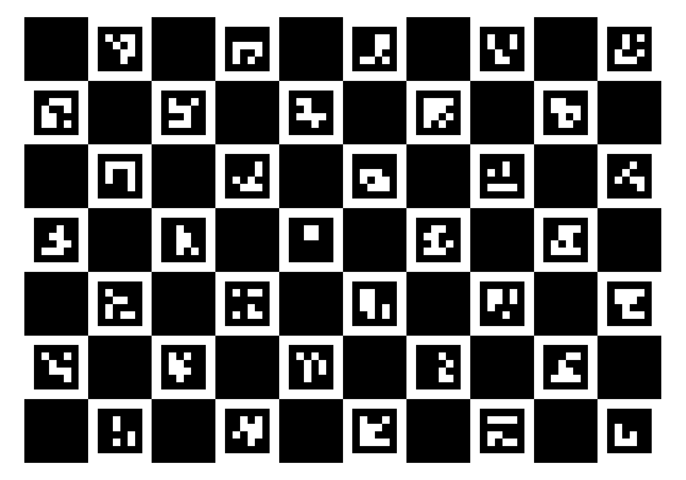
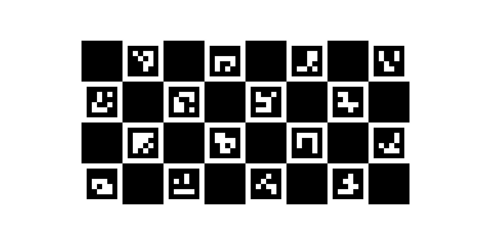

# Calibration

By default users do not hold a calibration target ([ADR 0006](adr/0006-calibration-without-user-held-targets.md)): the intrinsics start from a prior per camera model and are refined per camera from the dartboard, together with the extrinsics. The ChArUco calibration below remains a supported option: a camera calibrated with it starts the refinement from its own calibration instead of the model prior. It also makes the model priors and the reference for the method comparison (#46).

DartPilot calibrates each camera in two steps, both in the developer GUI `dartpilot_setup` ([ADR 0003](adr/0003-developer-gui.md)):

1. **Intrinsic calibration** (#44, #45): focal length, principal point and lens distortion of one camera, from views of a ChArUco pattern.
2. **Extrinsic calibration** (#13): each camera's pose relative to the board, from the dartboard itself. Not available yet.

## Calibration pattern

[charuco-10x7-DICT_4X4_50-marker-0.70.png](calibration/charuco-10x7-DICT_4X4_50-marker-0.70.png): ChArUco, 10 × 7 squares, dictionary `DICT_4X4_50`, markers 70 % of the square size. The detector expects exactly this pattern; patterns from other generators may differ in layout or marker IDs.

- **Phone or tablet:** open the file (the setup GUI shows a QR code for it), full screen, landscape, medium brightness (about 50 %), auto-rotation, auto-brightness, dark mode and night light off. A tablet is easier: a phone shows the markers so small that it has to come close to the camera, where the image gets soft. Hold a phone about 20 to 30 cm away.
- **Second display:** "Show full screen" on the intrinsic calibration page.
- **Print:** lay the print flat on glass or a table top. Its size does not matter for the intrinsics.

The file is generated with `dartpilot pattern docs/calibration/charuco-10x7-DICT_4X4_50-marker-0.70.png`; a test checks that it matches the pattern the detector expects.

### Phone pattern

[charuco-8x4-DICT_4X4_50-marker-0.75.png](calibration/charuco-8x4-DICT_4X4_50-marker-0.75.png): 8 × 4 squares, markers 75 % of the square size. A phone in landscape is about twice as wide as high, so the 10 × 7 pattern gets cells of only about 9 mm there and has to come so close to the camera that the image gets soft; on the phone pattern the cells are almost twice as large. Choose "Phone" on the intrinsic calibration page, which switches the detector and the QR code. It gives 21 corners per view instead of 54, so take more views; views of both patterns can be mixed in one calibration. Generated with `dartpilot pattern --phone docs/calibration/charuco-8x4-DICT_4X4_50-marker-0.75.png`.

A flat print of the 10 × 7 pattern is still the better target: it is larger, so it can stay further from the camera and reach the image corners.

## Capturing views

Set the focus first ([hardware](hardware.md)); it must not change afterwards. Keep the exposure automatic: the reference cameras amplify only in automatic mode, and the intrinsics do not depend on the exposure.

- Hold the pattern about 20 to 40 cm in front of the camera, so that it fills a third to two thirds of the image width. Closer than about 20 cm the image gets soft and fewer markers are recognised.
- Cover the whole image: centre, corners and edges. The lens distorts most at the edges.
- Tilt the pattern by 30 to 45 degrees in all directions and vary the distance; tilted views separate the focal length from the distance.
- Hold still for a moment at each pose; the view is captured automatically.
- 15 to 25 views are enough. After calibrating, remove views marked red and calibrate again.

## Checking the result

"Calibrate" fits all three distortion models (standard, rational, fisheye) and checks each on views it did not see: the views are split into five groups, each group is held out once, and its points are projected with the calibration of the other four. This held-out error does not shrink when a model with many coefficients bends itself around its own views, so it is the number to judge, not the fit error.

- The **recommended model** is the simplest one within 5 % of the lowest held-out error; it is selected automatically and can be changed by clicking another row.
- The **quality** is good below 0.5 px held-out error with at least 15 views and 75 % coverage, usable below 1.0 px. These thresholds are provisional and in pixels; the gate in board millimetres follows from the method comparison (#46) and the camera poses (#13).
- The image shows the held-out error per ninth of the image. Large values in the corners mean that more views with the pattern in the corners are needed, or that the model does not fit the lens.
- Views with more than twice the median error are marked red; "Remove red views" drops them, then calibrate again.
- "Load saved views" continues from the stored calibration of the selected camera.

The calibration is stored per USB port in `~/.local/share/dartpilot/calibration/intrinsics-usb-<port>.yml`, together with the views it was computed from and its held-out error.

## Refining all cameras from the board

Once every camera has its board plane (extrinsic page, steps 1 to 4), "Refine all cameras" fits all cameras to one board model together (#13, [ADR 0006](adr/0006-calibration-without-user-held-targets.md)):

- **Per camera:** the pose relative to the board, the focal length, the principal point and the lens distortion. The lens starts from the camera's own ChArUco calibration if it has one, else from the calibration of another camera of the same model (focal length ±2 %, principal point ±30 px), else from the board alone (radial distortion only). How far the refinement may move each value from that start is part of the stored record.
- **Per camera, from the detection:** the edge offset. The wires are bright, so the light/dark transition the detection finds lies beside the wire centre, towards the dark sector, alternately to either side of successive wires. On the reference cameras it is 0.5 to 0.7 mm; ignoring it left an error of about 1 mm alternating from wire to wire.
- **For all cameras together:** the radii of the outer bull edge and the treble centre line. The double ring centre keeps its nominal 166 mm as the scale reference.

The detected points stand on the wires, 1.2 mm above the playing surface; board points for darts are taken on the surface (z = 0).

Each camera is judged on wires it did not see: the wires are split into four groups, each group is held out once, and its points are projected onto the board with the refinement of the others. The **quality** is good below 0.5 mm of this held-out error and usable below 1.0 mm, provisional until #48 sets the error budget. The **uncertainty** is the 1-sigma position error over the scoring area that follows from the uncertainty of the camera's parameters.

On the reference cameras (board points as detected, before and after):

| Camera | Homography, held-out | Refinement, held-out | Uncertainty |
| - | - | - | - |
| 1 (own lens calibration) | 1.21 mm | 0.48 mm | ±0.15 mm |
| 2 (lens prior of camera 1) | 1.62 mm | 0.67 mm | ±0.18 mm |
| 3 (lens prior of camera 1) | 1.58 mm | 0.64 mm | ±0.18 mm |

The detection measures each radial wire on seven tracks through the singles, to a fraction of a pixel, and follows the slight bend the lens gives it towards the image edge, so the crossing with the double ring is no longer extrapolated along a straight line. On the stills of the reference cameras this lowered the mean held-out error from 0.70 to 0.54 mm in daylight and from 0.95 to 0.81 mm under the evening light; the table above was measured before.

The result is stored in `~/.local/share/dartpilot/calibration/extrinsics.yml`, together with the board points, the lens priors and the creation times of the board planes and intrinsics it was computed from. The page marks it as outdated when any of them changes.

## Calibration check

The page "Calibration check" watches every camera: every few seconds each camera averages ten frames, finds the empty board again and compares the points with where its stored refinement puts them (blue rings expected, green dots found). It needs no click on the sector 20: the orientation that fits the calibration is taken. The edge offset is measured again each time, because it changes with the light, not with the camera.

| Result | Meaning |
| - | - |
| Green, up to 1 mm | The calibration still holds. |
| Yellow, up to 2.5 mm | Other light than during the calibration, or the camera moved a little. Calibrate again if it stays. |
| Red, above 2.5 mm | The camera or the board has moved: calibrate it again on the extrinsic page. |
| Wrong port | The image fits the calibration of another camera much better: the cameras were plugged into other USB ports. |

On the stills of the reference cameras, a fresh detection matched its own refinement within 0.4 to 1.0 mm in the light it was made in and within 1.1 to 1.6 mm under evening light, while the calibration of another camera was off by 27 to 61 mm. The thresholds are provisional until #48 sets the error budget. Darts in the board pause the check ("No board").
